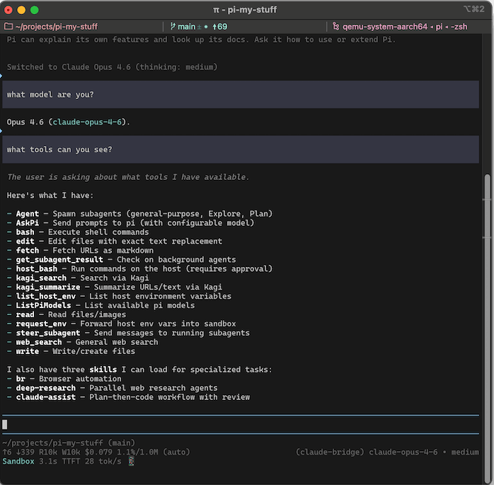
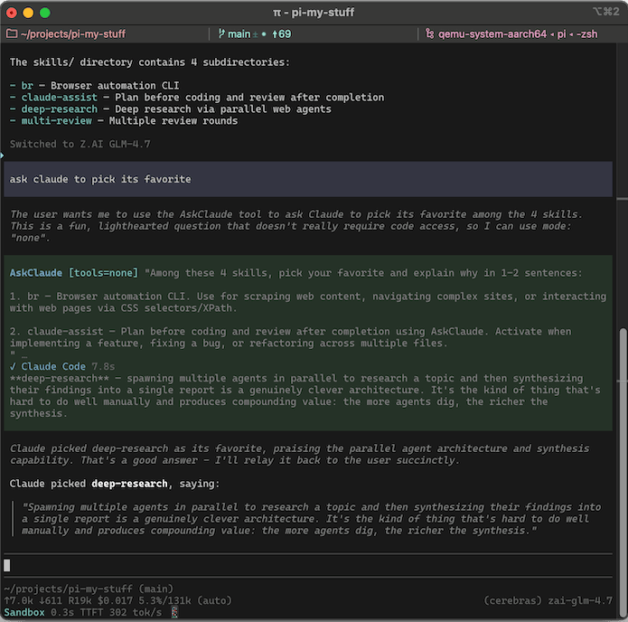

# pi-claude-bridge

[](https://www.npmjs.com/package/pi-claude-bridge)

**Use Claude models in pi with your Claude subscription.**

**Is this allowed?** Yes, as far as I can tell. Anthropic at one point [announced and then unannounced](https://support.claude.com/en/articles/15036540-use-the-claude-agent-sdk-with-your-claude-plan) a billing change for Agent SDK tools like this one. Things could change again, but right now the bridge uses your regular subscription quota just like Claude Code.

<p>
<a href="assets/claude-bridge1.png"></a>&nbsp;
<a href="assets/claude-bridge2.png"></a>
</p>


> [!NOTE]
> **There's another good option:** the pi maintainers now have their own Claude Code subscription provider, [pi-claude-code](https://github.com/earendil-works/pi-claude-code). The two work differently under the hood:
>
> - **pi-claude-bridge (this extension)** runs Claude Code through the [Agent SDK](https://github.com/anthropics/claude-agent-sdk-typescript) and keeps pi's message history in sync with a Claude Code session file on disk. Claude Code builds and sends every request itself, unmodified, with its own system prompt and pi's prompt sections added to it. It tries to stay true to how Claude Code normally runs.
>   - **Tradeoff:** complexity. Other extensions that change the system prompt mid-session, add messages to requests, or run subagents with their own prompts can fail.
> - **[pi-claude-code](https://github.com/earendil-works/pi-claude-code)** runs `claude -p` for each turn and points it at a local proxy that rewrites each request on its way to Anthropic: it swaps in pi's history and system prompt as-is and adjusts cache markers. It keeps no state of its own, so it's simpler and gets along better with other extensions.
>   - **Tradeoff:** editing inference requests on the wire is less clearly within the TOS, and Claude Code updates may introduce breaking changes without warning.


## Install

The bridge needs pi 1.5.1 or newer.

1. Install the extension:
   ```sh
   pi install npm:pi-claude-bridge
   ```
2. Log in to Claude Code with your Claude subscription: run `claude auth login`. The bridge uses Claude Code's login, *not* pi's `/login`.
3. In pi, pick a `claude-bridge/...` model with `/model`, e.g. `claude-bridge/claude-opus-5-5`. **Don't pick the `anthropic/...` models:** those are pi's own Anthropic provider and don't go through Claude Code or your subscription.

### Optional: AskClaude

To let other providers delegate tasks or questions to Claude Code, install the AskClaude tool: `pi install npm:pi-claude-bridge-askclaude` ([askclaude/](askclaude/README.md)).

## Usage

The model list comes from pi-ai's Anthropic catalog automatically. When pi-ai adds a new Claude model, it appears in `/model` after you update the package; no bridge update is needed. Dated snapshot ids (e.g. `claude-opus-4-5-20251101`) are not shown.

Claude Mythos 5.2 and 5.1 are listed too (at the bottom), though pi-ai leaves them out. Anthropic serves Mythos only to approved programs, so on accounts without access requests fail with a 404 "There's an issue with the selected model".

All current models run with 1M context. Opus 4.6 and Sonnet 4.6 need extra settings for 1M (see [Configuration](#configuration)).

pi's tools are bridged to Claude Code, but you continue to use pi as usual:

- Bash commands get Claude Code's 120-second default timeout since Claude expects it but pi's bash has no default limit.
- Skills are forwarded to Claude Code's system prompt.
- Steering mid-turn works and reaches Claude at the next tool boundary.

## Configuration

Create `~/.pi/agent/claude-bridge.json`

```json
{
  "provider": {
    "strictMcpConfig": true,
    "pathToClaudeCodeExecutable": "/home/you/.nix-profile/bin/claude"
  }
}
```

### Provider options

- `strictMcpConfig` - block MCP servers from `~/.claude.json` / `.mcp.json` (default `true`). Cloud MCP (Gmail/Drive via claude.ai OAuth) is always blocked.
- `autoMemoryEnabled` - enable Claude Code's auto-memory system (default `false`).
- `pathToClaudeCodeExecutable` - path to the `claude` binary. Useful if your OS/filesystem has the SDK's bundled musl/glibc binaries in a place where they can't run. For example, with Nix you can set the binary to `"/home/you/.nix-profile/bin/claude"`.
- `forceTwoHundredK` - array of model ids to pin to 200K context (bare id, no `[1m]` suffix). Use if pi-ai declares a model at 1M but Claude Code won't serve it on your plan.
- `plan` - set to `"max"` on a Max (or Team Premium/Enterprise) plan to run Opus 4.6 with 1M context (default `"pro"`).
- `longContextExtraUsage` - set to `true` to run Opus 4.6 (on Pro) and Sonnet 4.6 with 1M context, billed through Extra Usage.

### Model overrides

pi's `modelOverrides` in `~/.pi/agent/models.json` do not work correctly with pi-claude-bridge; they only apply to pi-side settings like compaction threshold. Overriding `contextWindow` or other fields requires editing `src/models.ts` directly. To pin a model to 200K, use `provider.forceTwoHundredK` instead.

### Environment variables

Claude Code inherits pi's environment. To set variables only for bridge requests (a proxy, a gateway, Bedrock settings), add an `env` object to a `claude-bridge` credential in `~/.pi/agent/auth.json`:

- Values override pi's environment.
- An empty value removes the variable.
- Extensions calling a bridge model can pass `env` per request the same way.

`CLAUDE_CONFIG_DIR`, `HOME` and `USERPROFILE` can't be set there (the turn fails), since the bridge reads Claude Code's session files through pi's own values.

This example sends bridge requests through a proxy and keeps an exported gateway (issue #107) away from Claude Code, so it uses your Claude login:

```json
{
  "claude-bridge": {
    "type": "api_key",
    "key": "not-used",
    "env": {
      "HTTPS_PROXY": "http://127.0.0.1:8080",
      "ANTHROPIC_BASE_URL": "",
      "ANTHROPIC_API_KEY": "",
      "ANTHROPIC_AUTH_TOKEN": ""
    }
  }
}
```

## Session history

The bridge compares conversation content before each fresh query:

- Unchanged history resumes the Claude Code session.
- Tree navigation and history edits retain Claude Code's records up to the last safe matching point, then continue in a new session. `/fork` and clone start from the parent session's Claude Code records the same way.
- Model changes and changed instructions import pi's history into a fresh Claude Code session.

Session pointers, content digests and record IDs are saved under `claude-bridge/sessions/` in pi's agent directory (`PI_CODING_AGENT_DIR`, default `~/.pi/agent`). They let the bridge recover its matching prefix after a restart. Running the same pi session simultaneously in multiple bridge processes is unsupported.

## Compatibility with other extensions

### Which injection routes reach Claude Code?

The bridge forwards pi's structured parts: project context files, skills, custom prompt, appended instructions, and custom prompt sections (`systemPromptOptions.sections`). It drops the rest. Measured against the request body (`diag/capture-proxy.mjs`):

| Route | Reaches Claude Code |
|---|---|
| `before_agent_start` -> `message` | Yes, as literal prompt text in the user turn |
| `context` editing the last user message | Yes, as literal prompt text |
| `--append-system-prompt` | Yes, with pi's appended instructions |
| `context_with_system` editing the system message | Yes when it wraps pi's prompt; the turn fails when it replaces it |
| `before_agent_start` -> `systemPromptOptions.sections` | Yes, one `<name>` block per section |
| `before_agent_start` -> `systemPrompt` | No, dropped |

Two things to watch for:

- Returning `systemPrompt` from `before_agent_start` makes pi replace the whole system prompt, discarding any `context_with_system` edit in the same run. Only one reaches the request.
- System-prompt edits work by *wrapping*. Replacing pi's prompt leaves the bridge with nothing to match, so it refuses the turn rather than send Claude Code a request missing your context files, skills and custom instructions. The error names the closest known prompt and where it diverged.

To add instructions, use `message`, `context`, or a system-message edit that keeps pi's prompt intact.

### Extensions that add a message to every request

Some extensions add a message from their `context` hook on every request without saving it to pi's history (pi-todo-rail does this with its todo list). Claude Code keeps each copy and puts its cache marker on it, but the next request no longer has that copy. Nothing cached after the system prompt can be reused: every request rewrites the whole prompt cache, and Claude Code restarts after every tool call. The bridge warns after three such requests in a row and quotes the message.

To fix it, disable the extension, or have it save the message with `pi.sendMessage` when its content changes so it stays in pi's history.

### Hooks written for Claude Code

`~/.claude/settings.json` hooks fire inside bridge turns, so a hook injecting Claude-specific guidance duplicates what pi's extensions already provide. A project's `.claude/settings.json` and `.claude/settings.local.json` are not loaded, so a repo's hooks, `apiKeyHelper` and `env` never run.

pi sets `PI_CODING_AGENT=true` for child processes, including the Claude Code child. A hook can skip itself on that:

```sh
[ -n "$PI_CODING_AGENT" ] && exit 0
```

Hooks do not fire on isolated summary queries.

You cannot rely on Claude Code's permission rules and PreToolUse hooks to block tools you don't want to run. Permissioning should take place on the Pi side when using the bridge.

### Compaction and branch summaries

pi runs compaction and branch summaries natively. The bridge routes their `cacheRetention: "none"` calls to isolated Claude Code queries, leaving the live session untouched until pi completes the history rewrite. Other extensions can provide summaries through pi's hooks.

### Extra Usage with plan limits left

Anthropic reads some system prompts as a third-party app's and bills those requests to Extra Usage even when your plan has room, or refuses them with "You're out of extra usage" when Extra Usage is off. pi's own prompt before pi 1.5 was one. The bridge warns when Claude Code reports a request billed to Extra Usage with no plan limit reached, and adds the same note to an "out of extra usage" error. Models you run at 1M through `longContextExtraUsage` are left out, since they bill Extra Usage by design. If you see it, look for an extension that adds text to the system prompt.

### Plan usage for footers and quota extensions

The bridge does not show plan usage itself. Claude Code sends a `rate_limit_event` when a usage window changes, and the bridge passes it to pi's `after_provider_response` event as `anthropic-ratelimit-unified-*` headers, using the Anthropic API's names (for example `anthropic-ratelimit-unified-5h-utilization`).

Events are not tied to one response. One that arrives after a turn has ended on a tool call is reported on the next provider call, and only the latest is kept. The bridge includes the headers it can make from the event: status, reset time, representative claim, overage status and reset, and utilization and reset for each window. The status code is always 200.

An extension that reads these headers for the built-in `anthropic` provider can also accept `claude-bridge` without other changes.

### Using with @gotgenes/pi-subagents

Requires the following in `~/.pi/agent/subagents.json`:

```json
{"promptInheritance": {"claude-bridge": "portable"}}
```

## Known issues

### Edits far back in history can still cost cache

The unchanged prefix is retained, but Anthropic's cache lookup has a limited lookback. A long rewritten suffix can prevent reuse of an earlier cache entry.

### File snapshots in rewritten history can be lost

Native records before the matching point keep their attachments. A rewritten suffix carries `@file` expansions, but not snapshots Claude Code recorded after editing files; the tool calls and results remain in pi's history.

### Changed instructions cost a cache miss

When project context (AGENTS.md/CLAUDE.md), skills, or extension-written instructions change (for example, after an edit and `/reload`), the next turn imports the conversation into a new Claude Code session so the model sees them. That turn re-sends the conversation uncached and drops earlier thinking. An extension that rewrites its system prompt section every turn pays this on every turn.

### Exported Anthropic environment variables override the Claude Code child (issue #107)

An exported `ANTHROPIC_BASE_URL`, `ANTHROPIC_API_KEY`, or `ANTHROPIC_AUTH_TOKEN` applies to bridge calls too. Unset them for the pi process, or blank them in a `claude-bridge` credential's `env` (see [Configuration](#configuration)), if you don't want that.

## Debugging

Set `CLAUDE_BRIDGE_DEBUG=1` to enable debug output:

- **Bridge log** at `claude-bridge.log` in pi's agent dir (`PI_CODING_AGENT_DIR`, default `~/.pi/agent`): provider calls, session sync decisions, tool results, CC stderr. Override location with `CLAUDE_BRIDGE_DEBUG_PATH`.
- **Per-query CC CLI logs** at `cc-cli-logs/<timestamp>-<tag>-<seq>.log` in the same directory: the subprocess's own debug stream; tag is `provider` (or `askclaude` for the AskClaude package). Shows CC's view of session loading, API requests, and tool calls.

When filing a bug about a session-resume failure (e.g. "No conversation found"), the most useful attachments are the `syncResult:` lines from the bridge log plus the matching `cc-cli-logs/` file for the failing query.

## Development

### Tests

`npm run test:unit` for offline tests. `npm test` adds integration tests that hit APIs; set `CLAUDE_BRIDGE_TESTING_ALT_MODEL` in `.env.test` for the alt-provider smoke test.

Integration tests spawn real `pi` and Claude Code subprocesses and need write access to `~/.claude` -- a sandbox that blocks it makes `--resume` fail with `No conversation found with session ID`.

## Acknowledgments

Originally based on [claude-agent-sdk-pi](https://github.com/prateekmedia/claude-agent-sdk-pi) by Prateek Sunal.
